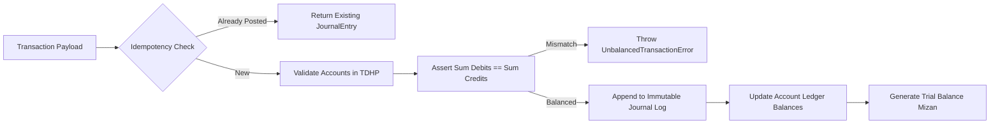

# ledger-core

[](https://github.com/yasinbalcik/ledger-core/actions/workflows/ci.yml)


Zero-dependency, immutable double-entry general ledger engine implemented in strict TypeScript with Turkish Uniform Chart of Accounts (TDHP - Tekdüzen Hesap Planı) and integer kuruş arithmetic.

Designed for FinTech backends, accounting ERP connectors, and multi-tenant financial ledgers where auditability and mathematical correctness are non-negotiable.

## Architectural Principles

- **Inviolable Balance Rule:** Every journal entry must satisfy $\sum \text{Debits} = \sum \text{Credits}$. Unbalanced transactions are rejected at the domain boundary with `UnbalancedTransactionError`.
- **Absolute Immutability:** Once posted, a journal entry cannot be modified or deleted. Errors are corrected via formal reversal entries (*Ters Kayıt*).
- **Integer Minor-Unit Math:** All monetary values are represented as integer kuruş (1 TRY = 100 kuruş). Eliminates IEEE 754 floating-point drift.
- **Idempotency Guarantees:** Network retries sharing the same `idempotencyKey` return the existing posted transaction without duplicate ledger mutation.
- **Turkish TDHP Native:** Built-in standard accounts for Turkish accounting regulations (100 Kasa, 102 Banka, 120 Alıcılar, 320 Satıcılar, 391 KDV, 600 Satışlar).

## Architecture



## Standard Chart of Accounts (TDHP)

| Code | Name | Type | Normal Balance |
| :--- | :--- | :--- | :--- |
| `100` | Kasa | ASSET | DEBIT (Borç) |
| `102` | Bankalar | ASSET | DEBIT (Borç) |
| `120` | Alıcılar (Müşteriler) | ASSET | DEBIT (Borç) |
| `153` | Ticari Mallar | ASSET | DEBIT (Borç) |
| `191` | İndirilecek KDV | ASSET | DEBIT (Borç) |
| `320` | Satıcılar | LIABILITY | CREDIT (Alacak) |
| `391` | Hesaplanan KDV | LIABILITY | CREDIT (Alacak) |
| `500` | Sermaye | EQUITY | CREDIT (Alacak) |
| `600` | Yurtiçi Satışlar | REVENUE | CREDIT (Alacak) |
| `770` | Genel Yönetim Giderleri | EXPENSE | DEBIT (Borç) |

Custom sub-accounts (e.g. `102.01` Garanti TL, `120.042` Acme A.Ş.) can be dynamically registered.

## Installation

```bash
npm install ledger-core
```

## Usage

### 1. Posting an E-Invoice Sale Entry

```typescript
import { GeneralLedger } from 'ledger-core';

const ledger = new GeneralLedger();

// Sales invoice: 10,000 TRY net + 2,000 TRY VAT (20%) = 12,000 TRY total
// Expressed in minor units (kuruş): 12,000.00 -> 1,200,000
const saleEntry = ledger.post({
  idempotencyKey: 'inv-post-2026-00042',
  date: '2026-10-05',
  description: 'E-Fatura EDM2026000000042 Satış Tahakkuku',
  lines: [
    { accountCode: '120', debit: 1_200_000, credit: 0, description: 'Müşteri Borcu' },
    { accountCode: '600', debit: 0, credit: 1_000_000, description: 'Yurtiçi Satış Geliri' },
    { accountCode: '391', debit: 0, credit: 200_000, description: 'KDV %20' },
  ],
});

console.log(`Posted Journal Entry: ${saleEntry.id} (Seq: ${saleEntry.sequenceNumber})`);
```

### 2. Posting the Bank Settlement (Reconciliation)

```typescript
// Bank collection of invoice: 12,000 TRY arrives in bank account
ledger.post({
  idempotencyKey: 'bank-settle-2026-00042',
  date: '2026-10-06',
  description: 'Banka Tahsilatı EDM2026000000042',
  lines: [
    { accountCode: '102', debit: 1_200_000, credit: 0, description: 'Banka Girişi' },
    { accountCode: '120', debit: 0, credit: 1_200_000, description: 'Alıcı Cari Kapatma' },
  ],
});
```

### 3. Generating a Trial Balance (Mizan)

```typescript
import { generateTrialBalance } from 'ledger-core';

const mizan = generateTrialBalance(ledger, '2026-10-31');

console.log(`Trial Balance Balanced: ${mizan.isBalanced}`);
console.log(`Total Turnover: ${mizan.totalDebitTurnover / 100} TRY`);

for (const row of mizan.rows) {
  console.log(
    `${row.accountCode.padEnd(8)} ${row.accountName.padEnd(25)} | ` +
    `Borç: ${(row.debitTotal / 100).toFixed(2)} | ` +
    `Alacak: ${(row.creditTotal / 100).toFixed(2)} | ` +
    `Kalan: ${((row.debitBalance - row.creditBalance) / 100).toFixed(2)}`
  );
}
```

### 4. Correcting Mistakes via Reversal (Ters Kayıt)

```typescript
// Creates an offsetting entry swapping debits and credits
const reversal = ledger.reverse(saleEntry.id, 'Customer cancellation notice');
```

## Running Tests

```bash
npm install
npm run typecheck
npm test
```

## License

MIT © Yasin BALÇIK
